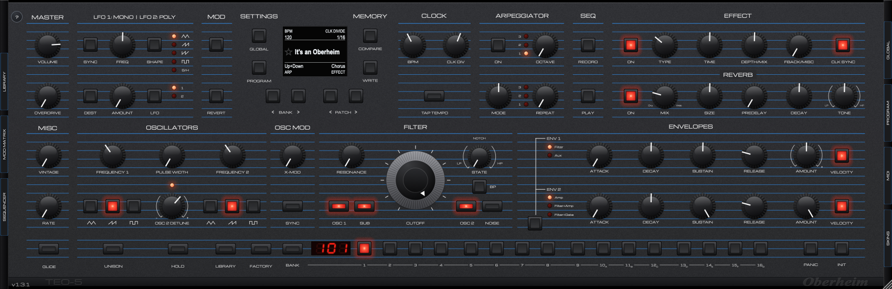
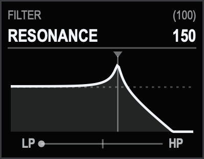
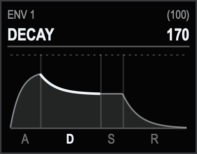
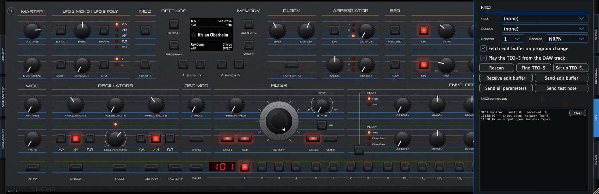
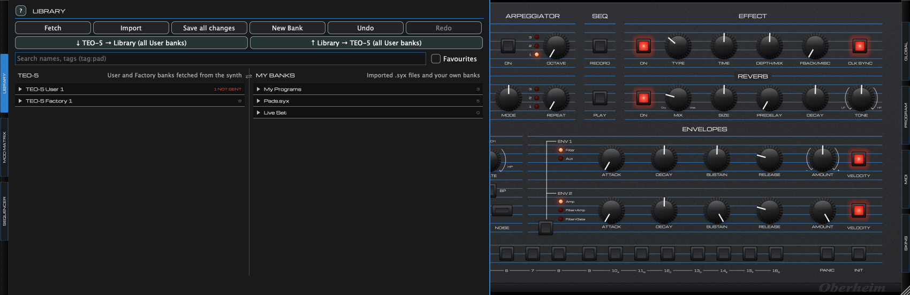
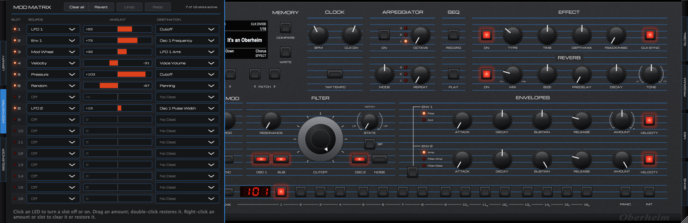
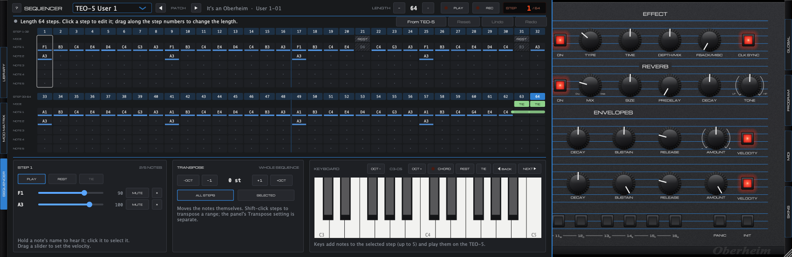
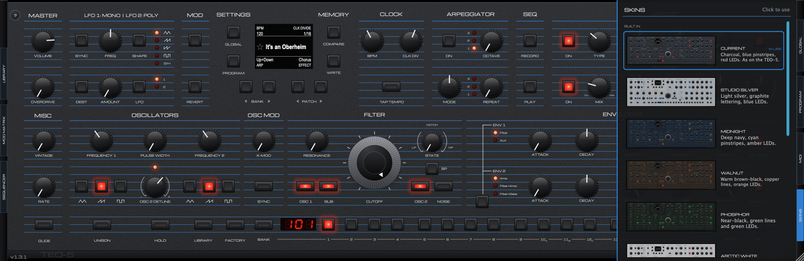

# TEO-5 Editor

Editor and librarian for the Oberheim TEO-5, as a VST3, Audio Unit and standalone app for macOS (Apple Silicon and
Intel, macOS 11 or later). Built with JUCE 8 and CMake.



> **Version 1.3.1.** Download the zip from the [releases page](https://github.com/jwalkermed/Teo-5-Editor/releases).
> It includes the full user's guide (PDF). In the editor, the **?** at the top left of the panel opens a guide to the
> front panel. What changed in each version: [CHANGELOG.md](CHANGELOG.md).

## What it does

- **Front panel:** every knob and button of the TEO-5, synced both ways over NRPN. Turn a knob on screen and the
  synth follows; turn one on the synth and the screen follows. While you turn a control, the display shows its new
  value and, in brackets, the value stored in the program.
- **Envelope and filter graphs:** turning an ENV 1 / ENV 2 knob, or the filter's CUTOFF, RESONANCE, STATE or BP,
  draws the envelope or filter response on the display. The graph fades back to the home page when you let go.
  These drawings are approximate; the TEO-5 doesn't publish the times or frequencies behind its knob positions.
- **Programs:** BANK and PATCH buttons (or the arrow keys), COMPARE, WRITE, REVERT, INIT (the Basic Program) and PANIC.
  Opening a saved DAW project sends its program back to the TEO-5's edit buffer.
- **Librarian:** your TEO-5 banks and your own banks side by side, with search, tags, favourites, drag and drop,
  .syx import and export, and undo.
- **Mod matrix:** all 16 slots. Right-click a knob to modulate it from any source, or send a source to any destination.
- **Sequencer:** a step editor for the program's 64-step, 5-note sequence, with step entry from the on-screen
  keyboard, the DAW track or the TEO-5's keys.
- **GLOBAL and PROGRAM drawers** for the settings that have no knob on the panel.
- **Skins:** ten built-in colour schemes, plus your own.

| | |
|---|---|
|  |  |

## Install

1. Download `TEO-5-Editor-<version>-macOS-Universal.zip` from the
   [releases page](https://github.com/jwalkermed/Teo-5-Editor/releases) and unzip it.
2. Open Terminal, type `bash ` (with a space), drag `install.command` from the unzipped folder into the window,
   and press Return. It installs:
   - `TEO-5 Editor.vst3` → `/Library/Audio/Plug-Ins/VST3`
   - `TEO-5 Editor.component` → `/Library/Audio/Plug-Ins/Components` (Audio Unit)
   - `TEO-5 Editor.app` → `/Applications` (standalone)

   It then runs a load test. Double-clicking `install.command` may be blocked, because the download isn't
   notarized; running it from Terminal avoids that.
3. Restart your DAW, or make it rescan its plug-ins. In Ableton Live, turn on **Use VST3 Plug-In System Folders**
   (Settings → Plug-Ins), then hold Option and click **Rescan**.

## Connecting to the TEO-5

1. On the TEO-5, press GLOBAL and set **MIDI Param Send = NRPN**, **MIDI Param Receive = NRPN**,
   **MIDI SysEx = On**, **MIDI SysEx Cable** = the connection you use (USB or MIDI), and **MIDI Program Send = On**.
   The editor won't get answers to its SysEx requests while Program Send is off.
2. In the editor, click the **MIDI** tab on the right end cheek. Pick the TEO-5's input and output ports and the
   channel, then click **Find TEO-5** to confirm the connection (it shows the synth's OS version).
3. Program changes and **Receive edit buffer** update the whole panel.

Panel edits go out as NRPN (or CC, if you choose it). **Send all parameters** sends every panel value to the synth.
The plug-in talks to the MIDI ports directly, because many DAWs don't pass SysEx through. MIDI settings are saved with
the DAW project. The MIDI drawer's monitor lists every message sent and received.



**Sequencer and arpeggiator:** when the TEO-5's MIDI Clock is set to In, In Thru or In No S/S, it only runs its
sequencer and arpeggiator while MIDI clock arrives. In Live, turn on **Sync** for the TEO-5's port under
Settings → Link, Tempo & MIDI.

## Librarian

Click the **LIBRARY** tab on the left end cheek, or the LIBRARY button on the panel.



- **Two panes:** **TEO-5** holds the User and Factory banks fetched from the synth. **MY BANKS** holds imported
  .syx files and banks you make yourself.
- **Fetch** gets the edit buffer, one bank, or all User or Factory banks from the TEO-5.
  **TEO-5 → Library** fetches all 16 User banks; **Library → TEO-5** sends your changes back.
- **Click** a program to load it into the TEO-5's edit buffer (this never writes memory). Shift- and Cmd-click
  select without loading.
- **Right-click** a program to load it, write it to TEO-5 memory, rename it, tag it, favourite it, copy, paste,
  duplicate, export or delete it. Right-click a bank to rename, import into, export, send or fetch it again.
- **Drag** programs to swap or move them, or between banks; Option-drag copies. Drop `.syx` files from Finder to
  import them.
- **NOT SENT** marks programs in the TEO-5 User banks that differ from what the synth holds. **Save all changes**
  writes them, and lists what will be overwritten first.
- **Search** matches names, sources and tags (`tag:pad` searches tags only). **Undo / Redo** (Cmd+Z /
  Shift+Cmd+Z) cover every library edit.
- **Factory banks are read-only.** Nothing writes to a factory location.

**WRITE** on the panel opens the library as a picker. Click a User slot or one of your banks to hear what is there,
then **Confirm** to save (or **Cancel** to put your edit back). Anything that overwrites TEO-5 memory asks first.

The library lives in `~/Documents/TEO5Editor/Library`: `library.json` holds the banks and their details, and
`programs/<id>.syx` holds one edit-buffer dump per program, which works with any SysEx librarian.

## Mod matrix



All 16 slots, each with source, amount and destination. Click a slot's light to switch it off and on again. The
drawer has Clear all, Revert, Undo and Redo. Right-click any knob that is a modulation destination to pick a source
for it; right-click a source's controls (LFO, ENV 1/2, OSC 2, NOISE) to send it somewhere.

## Sequencer



The program's step sequence: up to 64 steps with up to five notes each, with play / rest / tie per step, velocity,
muting, transpose, copy and paste. Turn on **REC** to enter steps from the on-screen keyboard, the DAW track or the
TEO-5's own keys. **PLAY** starts and stops the TEO-5's sequencer; with PLAY on, every DAW start restarts the
sequence at step 1. Edits go to the synth's edit buffer, never to memory. The **?** in the drawer explains it all.

## Skins



The SKINS tab picks one of ten built-in colour schemes, or makes your own (panel, lettering, pinstripes, LEDs and
drawers), which you can export and share.

## Build

Requirements: CMake 3.22 or later, Xcode (a C++17 compiler), JUCE 8.

```bash
# Option A: let CMake fetch JUCE 8.0.10
cmake -B build -DCMAKE_BUILD_TYPE=Release
# Option B: use a local JUCE checkout
cmake -B build -DCMAKE_BUILD_TYPE=Release -DJUCE_PATH=/path/to/JUCE

cmake --build build --config Release --target TEO5Editor_VST3 TEO5Editor_AU TEO5Editor_Standalone
packaging/make-zip.sh    # -> dist/TEO-5-Editor-<version>-macOS-Universal.zip
```

The build is universal (arm64 and x86_64). Artefacts land in `build/TEO5Editor_artefacts/Release/`, and are copied
to `/Library/Audio/Plug-Ins` and `/Applications` after each build; turn that off with
`-DTEO5_INSTALL_AFTER_BUILD=OFF`. `packaging/make-manual.sh` builds the user's guide PDF from `docs/manual`.

### Panel snapshot

`TEO5Snapshot` renders the editor offscreen to a PNG. The pictures in this README come from it:

```bash
cmake --build build --target TEO5Snapshot
TEO5_SKIN=0 build/TEO5Snapshot_artefacts/Release/TEO5Snapshot docs/screenshots/panel.png 1
```

A third argument opens a drawer: `library`, `modmatrix`, `sequencer`, `skins`, `global`, `program`, `drawer` (MIDI)
or `guide`.

## Source layout

- `Source/Params/`: `ParamTable`, the single parameter table (id, name, NRPN, CC, range, default) that drives the
  plug-in parameters, the UI and MIDI. Ranges are measured on a TEO-5, not taken from the spec.
- `Source/Midi/`: NRPN and SysEx encoding, the program's byte layout, the step sequence, the MIDI ports, and
  `MidiSync`, which keeps the editor and the TEO-5 in step.
- `Source/Library/`: the library model (banks, persistence, undo, clipboard, search), .syx import and export, and
  transfers to and from the synth.
- `Source/UI/`: the front panel, its widgets, skins, and the library, mod matrix, sequencer, settings and skins
  drawers.
- `Source/Tools/`: `TEO5Snapshot` and `TEO5PluginCheck` (a load test shipped in the zip).

## Tests

```bash
cmake --build build --target TEO5Tests TEO5LoopbackTest
build/TEO5Tests_artefacts/Release/TEO5Tests                # SysEx round trips, NRPN parsing, sequence bytes
build/TEO5LoopbackTest_artefacts/Release/TEO5LoopbackTest  # end to end against a fake TEO-5 on virtual ports
```

`docs/TEO5-MIDI-Implementation.txt` is the official MIDI spec; it's wrong in several places, and the editor follows
values measured on a real TEO-5. `VERIFY.md` lists what hasn't been confirmed on hardware.

## Licence

TEO-5 Editor, Copyright (C) 2026 The TEO-5 Editor project.

This program is free software: you can redistribute it and/or modify it under the terms of the GNU Affero
General Public License as published by the Free Software Foundation, either version 3 of the License, or (at
your option) any later version. It is distributed in the hope that it will be useful, but WITHOUT ANY WARRANTY;
without even the implied warranty of MERCHANTABILITY or FITNESS FOR A PARTICULAR PURPOSE. See `LICENSE` for
the full text.

Third-party software (JUCE, the VST3 and Audio Unit SDKs, the Michroma font) is listed in
`THIRD-PARTY-NOTICES.md`. Oberheim and TEO-5 are trademarks of their owner; this project is not affiliated with
or endorsed by Oberheim.
