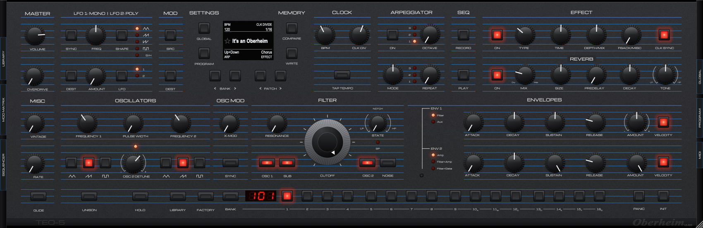

# TEO-5 Editor

VST3 / AU / Standalone editor-librarian for the Oberheim TEO-5 desktop module, built with JUCE 8 + CMake.



> Status: version 1.0. Front panel, MIDI sync, librarian, mod matrix and sequencer are done and in use with a TEO-5.

## Librarian

Click the **LIBRARY** tab on the left end cheek, or the LIBRARY button next to FACTORY.

- **Fetch** pulls the current edit buffer, the current bank, or all user/factory banks from the TEO-5, with a
  progress bar. Each fetched bank becomes a "TEO-5" bank; fetching the same bank again replaces it (undoable).
- **Click** (or **Return**) loads a program into the TEO-5 edit buffer. That never writes memory. The SELECT
  encoder steps through the list and loads after a short pause; VALUE jumps between banks.
- **Right-click** a program for: load, write to the current panel location, rename, tags, favourite, copy/paste,
  duplicate, export `.syx`, delete. Right-click a bank to rename, import into it, export it, send it to the TEO-5,
  re-fetch it, or delete it.
- **Drag** programs to reorder them or move them between banks. Drop `.syx` files from Finder to import them.
- **Search** matches names, sources and tags. `tag:pad` searches tags only. **Favourites** filters starred programs.
- **+ Current** saves the panel's current program into the selected bank.
- **Undo/Redo** (Cmd+Z / Shift+Cmd+Z) covers every library edit. Cmd+C / Cmd+V / Delete work on the selection.
- **COMPARE** on the panel toggles between your edit and the program as loaded, as on the hardware.
  **WRITE** stores the edit in the current BANK/program location. Double-click the OLED to rename the program.

Anything that overwrites TEO-5 memory (WRITE, "Write to TEO-5 memory", "Send bank to TEO-5") asks for
confirmation first and names the exact locations.

The library lives in `~/Documents/TEO5Editor/Library`: `library.json` holds banks and metadata, and
`programs/<id>.syx` holds one edit-buffer dump per program. Those files also work with any SysEx librarian.
A single exported program is an edit-buffer dump; an exported bank is 16 addressed program dumps.
`TEO5_LIBRARY_DIR` overrides the folder (the tests use this).

## Connecting to the TEO-5

1. On the TEO-5, press GLOBAL and set **MIDI Param Send = NRPN**, **MIDI Param Receive = NRPN**, **MIDI SysEx = On**,
   and set **MIDI SysEx Cable** to the connection you use (USB or MIDI).
2. In the editor, click the **MIDI** tab on the right end cheek (the GLOBAL/PROGRAM buttons also open it). Pick the TEO-5
   input/output ports and channel. Use **Find TEO-5** to confirm the connection (it shows the OS version).
3. One-time setup: click **Map dump layout…** (takes a few minutes; changes only the edit buffer and restores each
   value). Then type the current program name exactly as the OLED shows it and click **Locate name**.
   After that, program changes and **Receive edit buffer** update the whole panel.

Panel edits are sent immediately as NRPN (or CC, if selected), coalesced and spaced ~1 ms apart. Knob moves on the
TEO-5 update the panel. **MANUAL** sends every panel value to the synth. Program buttons send Bank Select + Program
Change and then fetch the edit buffer. The plugin talks to the ports directly because many DAWs don't pass SysEx.
Optionally it also routes through the host's MIDI in/out. MIDI settings are saved with the DAW project.

Built plugins are copied to `/Library/Audio/Plug-Ins/VST3` and `~/Library/Audio/Plug-Ins/Components` after
each build. Turn that off with `-DTEO5_INSTALL_AFTER_BUILD=OFF`.

## Build

Requirements: CMake ≥ 3.22, a C++17 compiler (Xcode / MSVC 2022), JUCE 8.

```bash
# Option A: let CMake fetch JUCE 8.0.10
cmake -B build -DCMAKE_BUILD_TYPE=Release
# Option B: use a local JUCE checkout
cmake -B build -DCMAKE_BUILD_TYPE=Release -DJUCE_PATH=/path/to/JUCE

cmake --build build --config Release --target TEO5Editor_VST3 TEO5Editor_AU TEO5Editor_Standalone
```

Artefacts land in `build/TEO5Editor_artefacts/Release/`. JUCE 8 bundles the VST3 SDK. To use an external
SDK, pass `-DTEO5_VST3_SDK=/path/to/vst3sdk`. AU is built on macOS only.

### Panel snapshot

`TEO5Snapshot` renders the editor offscreen to a PNG (used to compare against the hardware photo):

```bash
cmake --build build --target TEO5Snapshot
build/TEO5Snapshot_artefacts/Release/TEO5Snapshot docs/screenshots/panel.png 1.0
```

## Layout

- `Source/Params/`: `ParamTable` is the single table (id, name, NRPN, CC, range, default, kind) that drives
  the APVTS parameters, the UI and (soon) MIDI.
- `Source/UI/`: `TEO5LookAndFeel` (knob/button/LED rendering), `Widgets` (Knob, PanelButton, Led,
  SevenSegment, OledDisplay), `PanelComponent` (front panel laid out in the reference photo's pixel coordinates).
- `Source/Midi/`: `Nrpn` (encoder + stateful decoder), `SysEx` (packed-MS-bit pack/unpack, requests, dumps),
  `ProgramLayout` (dump byte layout + inference), `MidiPortManager` (direct ports, rate-limited sender),
  `MidiSync` (APVTS ⇄ TEO-5, program change, dumps, layout probe, host routing).
- `Source/Library/`: `LibraryModel` (banks/programs, JSON + .syx persistence, snapshot undo/redo, clipboard,
  search), `SyxIO` (.syx import/export), `HardwareTransfer` (background fetch / bank send).
- `Source/UI/LibraryDrawer`: the librarian UI.

## Tests

```bash
cmake --build build --target TEO5Tests TEO5LoopbackTest
build/TEO5Tests_artefacts/Release/TEO5Tests                # SysEx round-trip, NRPN parsing, layout inference
build/TEO5LoopbackTest_artefacts/Release/TEO5LoopbackTest  # end-to-end against a fake TEO-5 (virtual ports)
```
- `docs/TEO5-MIDI-Implementation.txt`: the spec the table is built from. `VERIFY.md` lists every unconfirmed item.

## Licence

TEO-5 Editor, Copyright (C) 2026 The TEO-5 Editor project.

This program is free software: you can redistribute it and/or modify it under the terms of the GNU Affero
General Public License as published by the Free Software Foundation, either version 3 of the License, or (at
your option) any later version. It is distributed in the hope that it will be useful, but WITHOUT ANY WARRANTY;
without even the implied warranty of MERCHANTABILITY or FITNESS FOR A PARTICULAR PURPOSE. See `LICENSE` for
the full text.

Third-party software (JUCE, the VST3 and Audio Unit SDKs, the Michroma font) is listed in
`THIRD-PARTY-NOTICES.md`. Oberheim and TEO-5 are trademarks of their owner; this project is not affiliated with
or endorsed by Oberheim.
